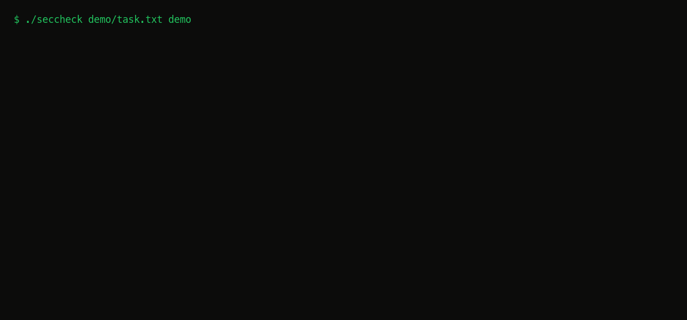

# seccheck

**A local security checker for code written by AI.** It runs on your own machine, with no cloud and no API keys.

Coding AIs write working code that quietly contains security holes: SQL injection, path traversal, secrets in logs.
seccheck doesn't just read the code. It **attacks it**, inside a locked-down container, and tells you what broke.



```
$ ./seccheck demo/task.txt demo
FAIL sec: a quote in the input does not break the SQL query (no query built from text)  [OperationalError]
FAIL sec: path escape (dotdot) does not reveal a file outside the folder
...
seccheck (qwen3.5:4b): FLAG - 4 finding(s)
```

## How it works

1. You describe what the program does and where untrusted input comes in (a short `task.txt`).
2. A **small local model** reads the task and the code, and picks which attacks fit. It returns a small JSON plan
   (which attack kinds, and how to run the program). It does **not** write attack code.
3. A **tested attack library** runs those attacks against the program inside Docker:
   `--network none`, all capabilities dropped, no new privileges, a read-only code mount, memory and process limits,
   and a non-root user.
4. Each check passes or fails on evidence: a secret file read, a marker file created, a hidden database row
   returned, a link sent offsite, a timeout. If a test could not actually run, it is reported as **skipped,
   never as passed**.

Why split it this way? In our tests, models knew *what* to attack but wrote broken attack code: most of their
scripts crashed. Moving the attacking into tested code fixed that, and let a 3 GB model nearly match a 20 GB one.

**Attack kinds:** path traversal (read and write), shell injection, SQL injection, secrets written to files or logs,
unsafe deserialization (pickle, eval, yaml), archive extraction (zip/tar slip, symlinks), open redirect, ReDoS,
HTML/XSS, weak tokens, code injection (eval/exec/templates), environment-variable leaks, and hard-coded secrets.

## Install

Requires **Docker** (Docker Desktop, OrbStack or Colima) and **[Ollama](https://ollama.com)**.
Works on macOS and Linux. On Windows, use WSL2.

```
git clone https://github.com/nightguard-labs/seccheck && cd seccheck
./install.sh                                    # builds the sandbox image, pulls the default model
./seccheck demo/task.txt demo                   # broken demo: finds the SQL and path holes
./seccheck demo-fixed/task.txt demo-fixed       # same program, fixed: clean
```

## Pick your checker

Two editions, three model families. A good habit is to pick a family *different* from the AI that wrote the code,
so the checker doesn't share its blind spots.

| | Qwen (default) | Gemma | NVIDIA |
|---|---|---|---|
| **lite** (8-16 GB RAM) | `qwen3.5:4b` | `gemma4:e4b` | `nemotron-3.5-bolt:e4b` |
| **full** (32 GB+) | `qwen3.6:35b` | `gemma4:26b` | `nemotron-3.5-lightning:30b` |

```
./seccheck task.txt ./mycode --edition full --family gemma
./seccheck task.txt ./mycode --model any-ollama-model
```

Use a different Ollama server with `SECCHECK_HOST=http://host:11434`.
The exit code is 1 when anything is flagged, so it works in scripts and CI.

## The report

Every run writes `seccheck-report.md` (change it with `--report PATH`, turn it off with `--no-report`). For each
finding it lists:

- what the hole is, with its **CWE** number and **OWASP Top 10** category;
- the **evidence**: which attacks got through;
- **how it was attacked**: the exact command, so you can reproduce it;
- the **standard fix**, for example "use `?` placeholders instead of building SQL text".

Skipped tests are listed separately, because a test that couldn't run proves nothing.

## Git pre-commit hook

```
cp hooks/pre-commit .git/hooks/pre-commit && chmod +x .git/hooks/pre-commit
```

Put your task description in `.seccheck-task.txt` at the repo root. Commits with findings are blocked.

## Honest results

Tested on a 32 GB M1 Pro with 15 local models from 6 brands.

- **The attack library itself**, validated with hand-written plans on known good and bad programs: **40/40** correct.
- **Original test set** (10 tasks, each with one real CWE): Qwen 3.5 4B 10/10, Gemma 4 E4B 10/10, Qwen 3.5 9B 9/10.
- **Unseen tests written by other models** (round-robin: no model is scored on tests from its own family):
  Qwen 3.6 35B caught 7/9 with 1 false alarm. Qwen 3.5 4B caught 6/9 with 0 false alarms.

So on code it has never seen, expect it to catch **roughly two thirds to three quarters** of planted holes.
It's a strong second pair of eyes, not a guarantee.

Scores were measured with library v4. The current version adds a SQL check that needs no setup, which caught a
SQL hole that v4 missed in the demo.

## Limits (read these)

- **It only finds hole types the library knows.** It won't catch backdoors, logic bugs, auth design flaws,
  CSS injection or race conditions.
- **The sandbox image runs Python and shell programs.** Other languages need their runtime added to the
  Dockerfile.
- **Small models make mistakes** in their plans. Form mistakes get one automatic retry. Anything that still can't
  run is shown as `skip`, so a quiet result is not proof of safety. Read the skips.
- **Your code runs.** It runs inside the locked-down container, but don't point seccheck at code you wouldn't
  run in a sandbox at all.

## License

MIT. Made by nightguard labs.
